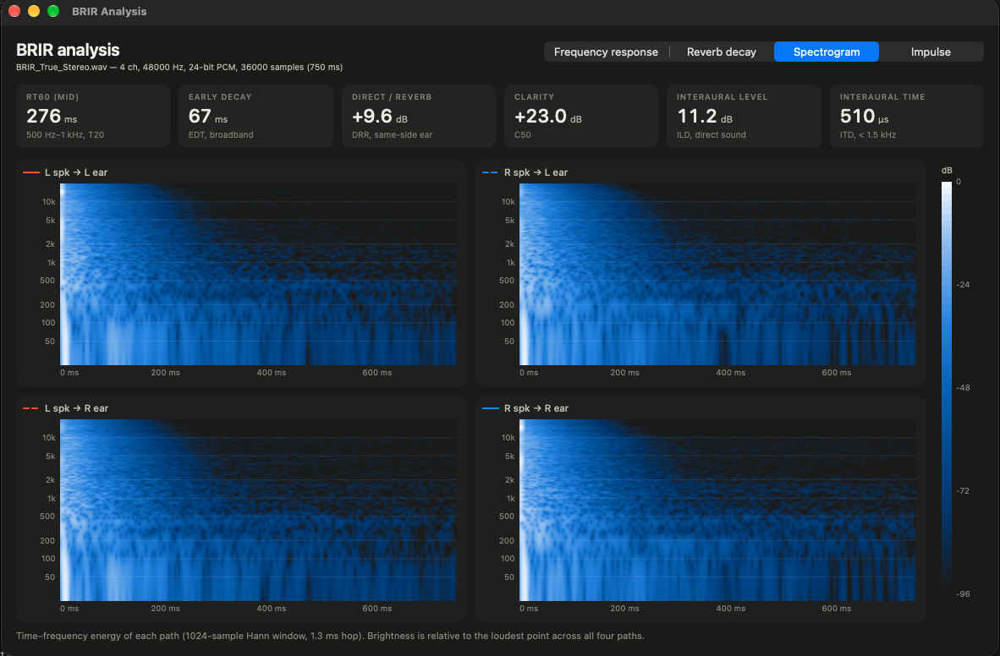

# BRIR Convolver

A native macOS app (Apple silicon, macOS 14.4+) that applies a BRIR to **all system audio** and plays the
result to any output device. It takes true-stereo, HeSuVi 14-channel and ASH Toolset 16-channel BRIRs, and can
virtualise a 7.1 speaker setup when it is fed multichannel audio (see [7.1 surround](#71-surround)). It can also run alongside a system-wide EQ app such as
GraphWorks EQ, with the EQ applied after the BRIR (see [Using it with GraphWorks EQ](#using-it-with-graphworks-eq)).

## Signal flow

```
Every app ──▶ [Core Audio process tap: originals muted] ──▶ BRIR Convolver ──▶ Output device
                                                            (64-bit FFT convolution)   (headphones / DAC)
```

There's no extra driver. The app uses Apple's process-tap API to capture the system mix and mute the
originals, so you don't get a dry signal plus a convolved one at the same time. It never taps its own
output, so its audio can't loop back into the chain.

## Setup

1. Double-click `Build and Test.command`. It builds the app, runs the self-test and installs it to
   `/Applications`. You need Xcode or the Command Line Tools (`xcode-select --install`).
2. Open **BRIR Convolver**, drop a BRIR WAV onto the window (a 4-channel true-stereo, 14-channel HeSuVi or
   16-channel file exported from ASH Toolset), and turn on *Enable system-wide convolution*.
3. The first time, macOS asks for **System Audio Recording** permission. Allow it. If you dismissed the
   prompt, go to System Settings → Privacy & Security → Screen & System Audio Recording →
   *System Audio Recording Only* and enable BRIR Convolver. Each rebuild changes the ad-hoc signature,
   so you may need to allow it again after rebuilding.
4. Under *Output*, keep *System default output* to follow whatever macOS is set to, or pick a device.

The headphone icon in the menu bar has quick enable/bypass controls. Closing the window keeps the app
running.


The **Status** section shows live performance figures:
- **Added delay** is the latency this app adds: Core Audio capture→output (measured from HAL timestamps)
  plus the convolver partition. The output device's own reported latency is shown separately, because
  it applies with or without this app.
- **DSP** is the compute time per audio callback (average and recent peak) against the callback's deadline.
- **Load** is that average as a share of the deadline.

## Using it with GraphWorks EQ

Running alongside GraphWorks EQ is supported, so you can keep using it for headphone EQ. Leave
GraphWorks EQ set as the macOS output, outputting to your DAC as usual, and keep BRIR Convolver's output
on *System default output* (or pick the GraphWorks EQ device explicitly):

```
Every app ──▶ [process tap] ──▶ BRIR Convolver ──▶ GraphWorks EQ virtual device
                                                              │
                                                  GraphWorks EQ app (headphone EQ)
                                                              │
                                                              ▼
                                                    Your DAC / headphones
```

The BRIR (virtual speakers + room) comes first and the headphone EQ comes last, which is the correct
order: the EQ corrects the headphone itself, so it should apply to whatever reaches the headphone.

BRIR Convolver never taps GraphWorks EQ: any audio process whose bundle ID or executable path contains
`graphworks` or `gweq` is excluded automatically, so GraphWorks EQ's own output doesn't loop back into
the chain. Other EQ apps that work through their own virtual output device should chain the same way
(only GraphWorks EQ has been tested): add their bundle IDs under *Advanced → Also never tap*.

## 7.1 surround

With the default *System audio* capture the app taps the stereo system mix, so only the front L/R speakers of a
7.1 BRIR are used. Apps only send surround audio to a device that offers multichannel output, so 7.1 needs a
loopback device:

1. Install a loopback driver such as [BlackHole](https://github.com/ExistentialAudio/BlackHole) (8ch or 16ch).
2. In **Audio MIDI Setup**, select BlackHole → *Configure Speakers* → *Multichannel* → **7.1 Surround**.
3. Make BlackHole the macOS output.
4. In BRIR Convolver, set *Input → Capture* to BlackHole, and set *Output* explicitly to your DAC or GraphWorks EQ
   (not *System default output*, which is now BlackHole itself).
5. Load a HeSuVi or 16-channel BRIR.

```
Every app ──▶ BlackHole (7.1) ──▶ BRIR Convolver ──▶ GraphWorks EQ / DAC
                                  (8 in → 2 ears)
```

*Channel layout* defaults to the device's speaker configuration from Audio MIDI Setup. If the device doesn't
report one, the standard order L R C LFE Ls Rs Lrs Rrs is used. You can also pick an order by hand. The status
line shows which input feeds which virtual speaker.

- **Stereo sources** play through FL/FR only, exactly as with the stereo tap.
- **LFE** is played through the BRIR's LFE speaker, or through the centre speaker when the LFE BRIR is just a copy
  of the centre one (as ASH exports it). *LFE level* sets its gain (0 dB by default; some players expect +10 dB at
  playback) or turns it off.
- **Missing speakers:** if the BRIR lacks a speaker the input has (for example 7.1 input on a true-stereo BRIR), its
  channel folds onto the nearest available speakers at −3 dB.
- **16-channel files:** ASH lets you choose the speaker order at export. Pick the same order under
  *16-channel speaker order*.
- **Dolby Atmos** is rendered by the playing app to whatever bed the device offers (7.1 here); height channels
  aren't simulated.

## BRIR analysis

Click **Analysis…** in the main window, or choose *BRIR Analysis…* from the menu-bar icon, to inspect
the loaded impulse response. For 7.1 BRIRs, a picker chooses the front, side or back speaker pair. Orange is the left speaker and blue the right. Solid lines are the
same-side ear and dashed lines the opposite ear. Hover any chart for exact values, and click a legend
entry to hide that path. The tiles across the top summarise reverb time (RT60), early decay time (EDT),
direct-to-reverberant ratio (DRR), clarity (C50) and the interaural level and time differences (ILD, ITD).

**Frequency response:** the EQ the BRIR applies on each speaker-to-ear path, with ¹⁄₄₈ to ⅓-octave smoothing.
An *Ear sum* mode shows the net colouration of centred content.


**Reverb decay:** Schroeder energy-decay curves for each path over the 1 ms peak envelope, plus RT60 per
octave band.


**Spectrogram:** time–frequency energy of all four paths on a shared dB scale.



**Impulse:** the raw waveforms over the first 3–100 ms, showing the direct sound, the interaural delay and
level difference, and the first reflections.


## Audio quality notes

- **The audio stream is never resampled by this app.** Convolution runs at whatever rate the output
  device is running (for example GraphWorks EQ's device). If that rate isn't the BRIR's native rate, only the
  *impulse response* is resampled. That happens once, offline, with a 64-zero-crossing Kaiser-windowed
  sinc in double precision. The status line says "IR native rate" or "IR resampled from …".
- **64-bit DSP.** The WAV is decoded exactly to double. FFTs, spectral multiply-accumulate and the
  inverse transform are all double precision (Accelerate/vDSP). The self-test checks the output against
  a direct time-domain convolution, and the error should sit at the Float32 output floor (≈ −140 dB or better).
- **A/B and bypass.** Hold the **A/B** button to hear the original without the BRIR, with the preamp
  still applied, so you can compare at matched levels. The *Bypass* switch is different: it is a
  bit-exact passthrough (no preamp), so stereo output is the input sample-for-sample. Multichannel input is
  downmixed to stereo (centre and surrounds at −3 dB, LFE omitted). Both crossfade over
  30 ms and keep the same latency as the convolved path, so switching causes no timing shift. The
  self-test checks both: bypass bit for bit, and A/B as exactly the input times the preamp.
- **Adaptive preamp.** The preamp starts at 0 dB and is lowered only when the output would otherwise exceed
  −0.01 dBFS, and then only as far as needed. Each partition's output is computed one block before it plays, so
  the gain drops before the loud samples go out. Nothing clips, and there is no extra latency. The gain never
  rises on its own, so quiet material stays at full level until something loud needs room. Press *Reset to
  0 dB* after a loud passage, or load a different BRIR, to start again. Apart from those gain steps the
  processing is linear; there is no limiter or compressor. Only sample peaks are measured, not inter-sample peaks.
- **Latency** = partition size (256 samples = 5.3 ms at 48 kHz) plus the device IO buffer.
  Smaller partitions lower the latency and cost more CPU. The self-test prints CPU cost for each size.
- The render thread does no allocation, locking or Objective-C messaging.

## Channel order

| Channels | Layout |
|---|---|
| 2 | Symmetric pair: same-side ear, opposite ear |
| 4 | True stereo, default **L→L, L→R, R→L, R→R** (Equalizer APO / ASH Toolset). An alternative order is in the picker. |
| 14 | HeSuVi: FL-L FL-R SL-L SL-R BL-L BL-R FC-L FR-R FR-L SR-R SR-L BR-R BR-L FC-R |
| 16 | ASH Toolset: 8 speakers × (left ear, right ear), in the speaker order chosen at export (default FL FR FC LFE SL SR BL BR) |

## Troubleshooting

- **Silence after enabling:** check the System Audio Recording permission (step 3) and that the
  *In* meter moves while something plays. With a loopback capture device, check that it is the macOS output
  and that BRIR Convolver's Output is a different device.
- **Clicks or dropouts:** raise the partition size, or try turning off *Drift compensation*.
- **Using GraphWorks EQ (or another EQ app) and it isn't listed under "Not tapping":** add its bundle ID
  under *Advanced → Also never tap*.
- Quitting the app removes the tap, and every other app is unmuted immediately.

## Rebuild / self-test only

```
./build.sh --test                  # self-test with built-in synthetic BRIRs (stereo and 7.1)
./build.sh --test path/to/brir.wav # or with your own
```
