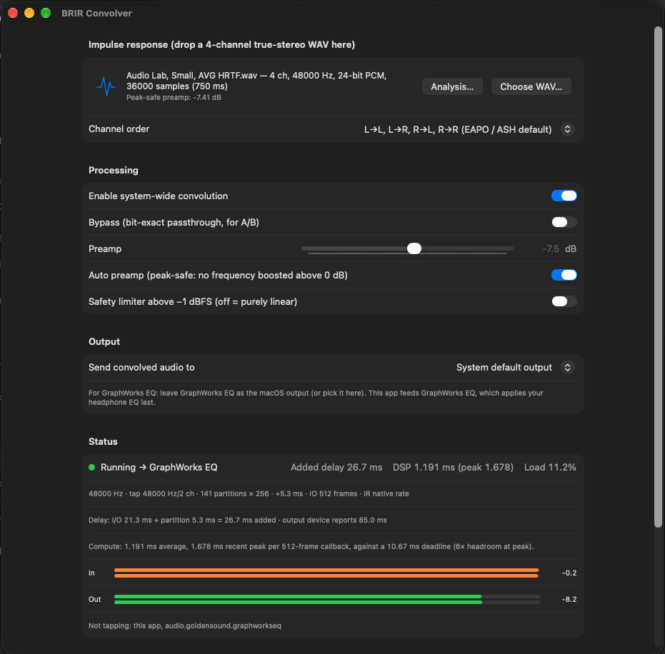
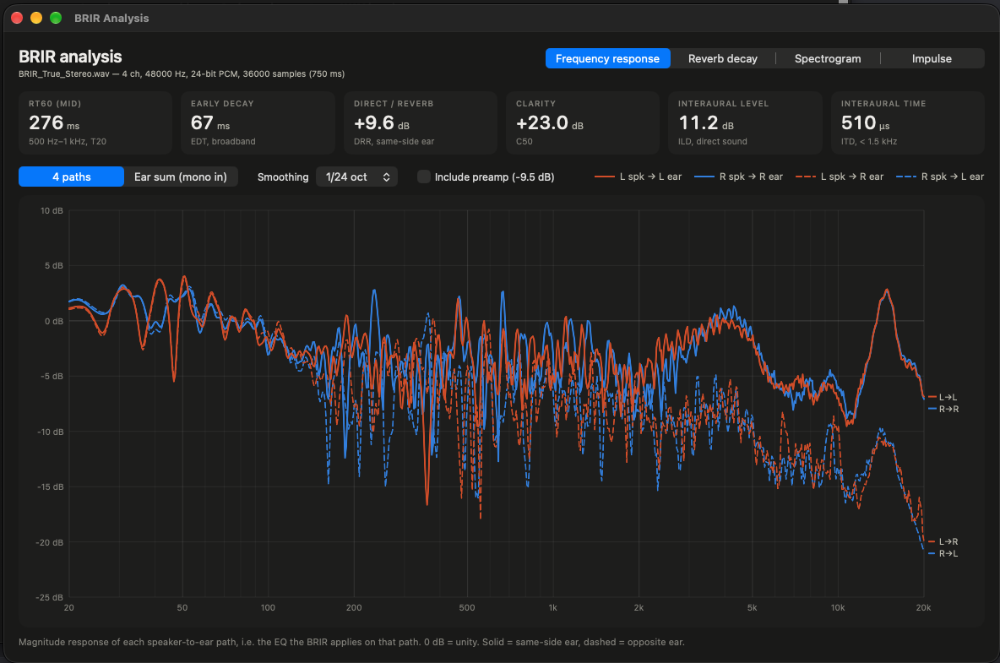
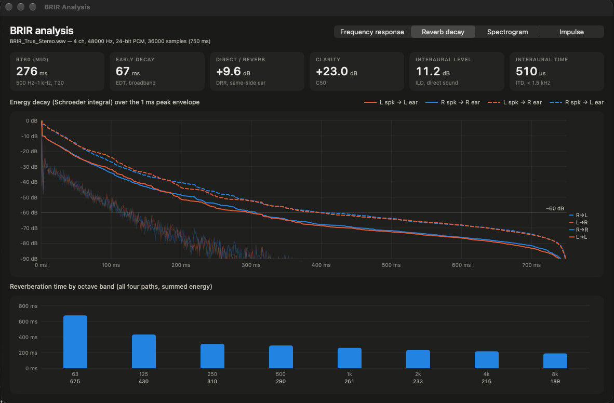
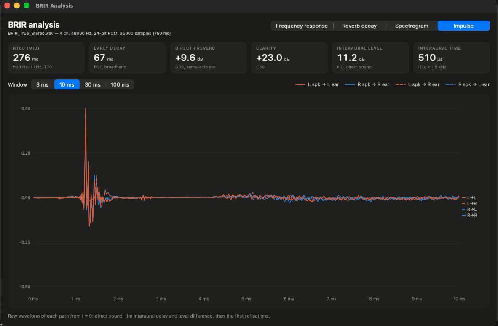

# BRIR Convolver

A native macOS app (Apple silicon, macOS 14.4+) that applies a true-stereo BRIR to **all system audio**
and plays the result to any output device. It can also run alongside a system-wide EQ app such as
GraphWorks EQ, with the EQ applied after the BRIR (see [Using it with GraphWorks EQ](#using-it-with-graphworks-eq)).

## Signal flow

```
Every app ──▶ [Core Audio process tap: originals muted] ──▶ BRIR Convolver ──▶ Output device
                                                            (64-bit FFT convolution)   (headphones / DAC)
```

There's no extra driver. The app uses Apple's process-tap API to capture the system mix and mute the
originals, so you don't get a dry signal plus a convolved one at the same time. It never taps its own
output, so its audio can't loop back into the chain.

## Setup

1. Double-click `Build and Test.command`. It builds the app, runs the self-test and installs it to
   `/Applications`. You need Xcode or the Command Line Tools (`xcode-select --install`).
2. Open **BRIR Convolver**, drop your 4-channel true-stereo BRIR WAV onto the window (for example one
   exported from ASH Toolset), and turn on *Enable system-wide convolution*.
3. The first time, macOS asks for **System Audio Recording** permission. Allow it. If you dismissed the
   prompt, go to System Settings → Privacy & Security → Screen & System Audio Recording →
   *System Audio Recording Only* and enable BRIR Convolver. Each rebuild changes the ad-hoc signature,
   so you may need to allow it again after rebuilding.
4. Under *Output*, keep *System default output* to follow whatever macOS is set to, or pick a device.

The headphone icon in the menu bar has quick enable/bypass controls. Closing the window keeps the app
running.



The **Status** section shows live performance figures:
- **Added delay** is the latency this app adds: Core Audio capture→output (measured from HAL timestamps)
  plus the convolver partition. The output device's own reported latency is shown separately, because
  it applies with or without this app.
- **DSP** is the compute time per audio callback (average and recent peak) against the callback's deadline.
- **Load** is that average as a share of the deadline.

## Using it with GraphWorks EQ

Running alongside GraphWorks EQ is supported, so you can keep using it for headphone EQ. Leave
GraphWorks EQ set as the macOS output, outputting to your DAC as usual, and keep BRIR Convolver's output
on *System default output* (or pick the GraphWorks EQ device explicitly):

```
Every app ──▶ [process tap] ──▶ BRIR Convolver ──▶ GraphWorks EQ virtual device
                                                              │
                                                  GraphWorks EQ app (headphone EQ)
                                                              │
                                                              ▼
                                                    Your DAC / headphones
```

The BRIR (virtual speakers + room) comes first and the headphone EQ comes last, which is the correct
order: the EQ corrects the headphone itself, so it should apply to whatever reaches the headphone.

BRIR Convolver never taps GraphWorks EQ: any audio process whose bundle ID or executable path contains
`graphworks` or `gweq` is excluded automatically, so GraphWorks EQ's own output doesn't loop back into
the chain. Other EQ apps that work through their own virtual output device should chain the same way
(only GraphWorks EQ has been tested): add their bundle IDs under *Advanced → Also never tap*.

## BRIR analysis

Click **Analysis…** in the main window, or choose *BRIR Analysis…* from the menu-bar icon, to inspect
the loaded impulse response. Orange is the left speaker and blue the right. Solid lines are the
same-side ear and dashed lines the opposite ear. Hover any chart for exact values, and click a legend
entry to hide that path. The tiles across the top summarise reverb time (RT60), early decay time (EDT),
direct-to-reverberant ratio (DRR), clarity (C50) and the interaural level and time differences (ILD, ITD).

**Frequency response:** the EQ the BRIR applies on each speaker-to-ear path, with ¹⁄₄₈ to ⅓-octave smoothing.
An *Ear sum* mode shows the net colouration of centred content.



**Reverb decay:** Schroeder energy-decay curves for each path over the 1 ms peak envelope, plus RT60 per
octave band.



**Spectrogram:** time–frequency energy of all four paths on a shared dB scale.


**Impulse:** the raw waveforms over the first 3–100 ms, showing the direct sound, the interaural delay and
level difference, and the first reflections.



## Audio quality notes

- **The audio stream is never resampled by this app.** Convolution runs at whatever rate the output
  device is running (for example GraphWorks EQ's device). If that rate isn't the BRIR's native rate, only the
  *impulse response* is resampled. That happens once, offline, with a 64-zero-crossing Kaiser-windowed
  sinc in double precision. The status line says "IR native rate" or "IR resampled from …".
- **64-bit DSP.** The WAV is decoded exactly to double. FFTs, spectral multiply-accumulate and the
  inverse transform are all double precision (Accelerate/vDSP). The self-test checks the output against
  a direct time-domain convolution, and the error should sit at the Float32 output floor (≈ −140 dB or better).
- **A/B and bypass.** Hold the **A/B** button to hear the original without the BRIR, with the preamp
  still applied, so you can compare at matched levels. The *Bypass* switch is different: it is a
  bit-exact passthrough (no preamp), so the output is the input sample-for-sample. Both crossfade over
  30 ms and keep the same latency as the convolved path, so switching causes no timing shift. The
  self-test checks both: bypass bit for bit, and A/B as exactly the input times the preamp.
- **Linear by default.** The preamp is an exact scalar gain. The optional limiter is **off** by default.
  *Auto preamp* sets the gain so that no frequency, at either ear, is boosted above 0 dB, using
  max(|LL|+|RL|, |LR|+|RR|). Watch the clip counter if you raise the preamp by hand.
- **Latency** = partition size (256 samples = 5.3 ms at 48 kHz) plus the device IO buffer.
  Smaller partitions lower the latency and cost more CPU. The self-test prints CPU cost for each size.
- The render thread does no allocation, locking or Objective-C messaging.

## Channel order

For a 4-channel file the default order is **L→L, L→R, R→L, R→R**, the Equalizer APO / ASH-Toolset
convention: channels 1 and 4 are the strong same-side ear paths and channels 2 and 3 are the
opposite-side paths. If the stereo image sounds mirrored or odd, try the alternative order in the picker.

## Troubleshooting

- **Silence after enabling:** check the System Audio Recording permission (step 4) and that the
  *In* meter moves while something plays.
- **Clicks or dropouts:** raise the partition size, or try turning off *Tap drift compensation*.
- **Using GraphWorks EQ (or another EQ app) and it isn't listed under "Not tapping":** add its bundle ID
  under *Advanced → Also never tap*.
- Quitting the app removes the tap, and every other app is unmuted immediately.

## Rebuild / self-test only

```
./build.sh --test                  # self-test with a built-in synthetic BRIR
./build.sh --test path/to/brir.wav # or with your own
```
